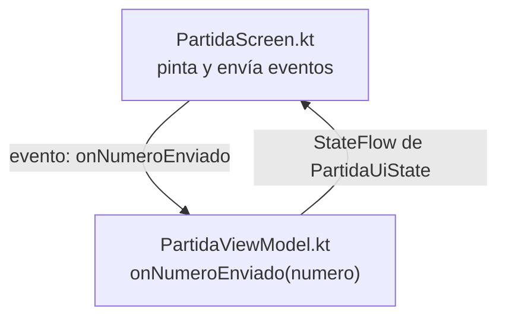

# EJEMPLO de README: «Número secreto»

> **Esto es un ejemplo, no tu README.** Está hecho para un proyecto **simulado**, un juego distinto
> (adivinar un número secreto), con tres niveles, un temporizador y tres pantallas. Los nombres de
> paquetes, ficheros y funciones son **inventados**. Sirve para ver **qué nivel de detalle** se espera
> en cada apartado. Tu README tiene que explicar **tu** proyecto, con **tus** nombres reales: un texto
> que valdría para cualquier proyecto no puntúa.

---

# Memory: Número secreto

## 1. Datos del proyecto

| | |
| :--- | :--- |
| **Autor/a** | Alumna Ejemplo Ficticia |
| **Módulo / curso** | PMDM · 2º DAM · 2026/2027 |
| **Temática** | Adivinar un número secreto con pistas «más alto» y «más bajo» |

## 2. Temática y fuente de las imágenes

El juego consiste en adivinar un número escogido al azar. Cada intento recibe una pista. La interfaz usa un
estilo de «caja fuerte»: la combinación se escribe con un teclado numérico y la caja se abre al acertar.

| Imagen (fichero en `res/drawable`) | Autoría o fuente | Licencia |
| :--- | :--- | :--- |
| `ic_caja_cerrada.xml`, `ic_caja_abierta.xml` | Dibujadas por mí como vectores | Propia |
| `ic_pista_mas.xml`, `ic_pista_menos.xml` | Dibujadas por mí como vectores | Propia |
| `ic_candado.xml` | Material Symbols (Google), «lock» | Apache 2.0 |

## 3. Captura o GIF

En un README real, aquí va un GIF tuyo con una partida: elección de nivel, intentos con pistas y pantalla final. Se enlaza así, con la ruta de tu fichero dentro del proyecto:

```markdown

```

## 4. Cómo compilar, ejecutar y probar

```bash
./gradlew assembleDebug          # compila la app
./gradlew testDebugUnitTest      # ejecuta los tests unitarios (9 tests del ViewModel)
```

El juego tiene **3 niveles**:

| Nivel | Rango del número | Intentos máximos |
| :--- | :---: | :---: |
| Fácil | 1 a 10 | 5 |
| Medio | 1 a 50 | 7 |
| Difícil | 1 a 100 | 8 |

## 5. Organización y estructura del proyecto

### 5.1. Paquetes

```text
com.pm2627.p1ev.memory
├── MainActivity.kt        ← punto de entrada: arranca el tema y la navegación
├── juego/                 ← qué es el juego, sin nada de pantalla
├── navegacion/            ← destinos y pila de Navigation 3
└── ui/
    ├── inicio/            ← pantalla de elección de nivel
    ├── partida/           ← pantalla, ViewModel y estado de la partida
    ├── final/             ← pantalla de resultado
    └── theme/             ← colores, tipografía y tema
```

### 5.2. Ficheros importantes

| Fichero | Qué hace |
| :--- | :--- |
| `juego/Nivel.kt` | `enum class Nivel` con el rango y el máximo de intentos de cada nivel |
| `ui/partida/PartidaUiState.kt` | `data class PartidaUiState`: todo lo que pinta la pantalla de partida (intentos, pista, segundos, si ha acabado…). Es inmutable |
| `ui/partida/PartidaViewModel.kt` | Las **reglas**: comprueba el número, calcula la pista, cuenta intentos y controla el temporizador con un `Job` |
| `ui/partida/PartidaScreen.kt` | Solo **pinta** el `PartidaUiState` y envía eventos (`onNumeroEnviado`). No decide nada |
| `ui/inicio/InicioScreen.kt` | Lista los tres niveles y avisa de cuál se ha elegido |
| `ui/final/FinalScreen.kt` | Muestra los intentos y el tiempo que recibe como argumentos |
| `navegacion/Destinos.kt` | Los tres destinos. `Partida` recibe el `Nivel`; `Final` recibe intentos y segundos |
| `navegacion/AppNavegacion.kt` | La pila y el `NavDisplay`: decide qué pantalla se muestra |
| `test/.../PartidaViewModelTest.kt` | Tests del ViewModel: acertar, fallar con pista y quedarse sin intentos |

### 5.3. Cómo fluye un evento

Ejemplo: el jugador escribe un número y pulsa **Probar**.

1. **Pantalla.** En `PartidaScreen.kt`, el botón de `Probar` llama a `onNumeroEnviado(numero)`. La pantalla **no comprueba nada**: solo envía el número.

2. **Conexión.** En `AppNavegacion.kt`, `onNumeroEnviado` está conectado con `viewModel::onNumeroEnviado`.

3. **ViewModel.** `PartidaViewModel.onNumeroEnviado(numero)` compara con el número secreto. Si no coincide, decide la pista («más alto» o «más bajo») y suma un intento.

4. **Estado.** Con `_uiState.update { it.copy(intentos = it.intentos + 1, pista = nuevaPista) }` crea un `PartidaUiState` **nuevo**, y el `StateFlow` lo emite.

5. **Pantalla otra vez.** `AppNavegacion.kt` lo recoge con `collectAsStateWithLifecycle()`, `PartidaScreen` se recompone con el estado nuevo, y se ve el intento y la pista.



### 5.4. Decisiones de diseño

- **El número secreto vive en el ViewModel y no en el `UiState`.** La pantalla no necesita conocerlo, y así no hay forma de leerlo desde ella.

- **El temporizador es un `Job` en `PartidaViewModel`.** Antes de lanzar uno nuevo compruebo con `isActive` que no haya otro en marcha, para que no cuente doble al volver a la app.

- **La pausa usa `LifecycleResumeEffect` en `PartidaScreen.kt`.** Al salir de la app llama a `onPausar()` y al volver a `onReanudar()`.

- **`Final` recibe solo números sencillos** (intentos y segundos), no el estado entero de la partida.

- **El generador de números aleatorios se pasa por constructor al ViewModel**, para poder usar uno fijo en los tests.

## 6. Mejoras opcionales

| Mejora | API que usa | Fichero y función | Documentación seguida |
| :--- | :--- | :--- | :--- |
| Vibración al fallar y al acertar (+0,5) | `LocalHapticFeedback` | `PartidaScreen.kt` · `EfectoHaptico` | [Haptics en Android](https://developer.android.com/develop/ui/views/haptics) |

La vibración **corta** se lanza cuando cambia la pista del estado: `EfectoHaptico` observa `estado.pista` con un `LaunchedEffect` y llama a `performHapticFeedback` con un tipo distinto para el acierto y el fallo.

## 7. Limitaciones conocidas

- El teclado numérico no limita las cifras al rango del nivel: se valida en el ViewModel y se ignora lo que se sale.

- La vibración solo funciona en dispositivos con motor háptico; en el emulador no se nota.

- No hay modo oscuro adaptado a todas las pantallas.
