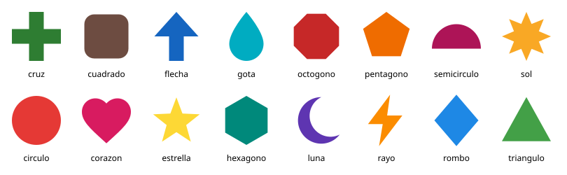

# Recursos de aprendizaje: imágenes de prueba para las cartas

Rama de **recursos** de la plantilla del proyecto de memoria. No cambia el código de la plantilla (`main`): solo trae material para trabajar en clase el tema de las imágenes y los recursos de Android.

## Qué hay

16 figuras como **vector drawables** (`carta_*.xml`): círculo, corazón, cruz, cuadrado, estrella, flecha, gota, hexágono, luna, octógono, pentágono, rayo, rombo, semicírculo, sol y triángulo. Son dibujos propios, sin derechos de terceros: puedes usarlos en tu proyecto sin citar ninguna fuente.



Todo está también en [`imagenes-prueba.zip`](imagenes-prueba.zip).

## Cómo usarlas

1. Copia los ficheros `carta_*.xml` en `app/src/main/res/drawable/` de tu proyecto.

2. Haz una lista con sus ids en tu código:

    ```kotlin
    val dibujos: List<Int> = listOf(R.drawable.carta_circulo, R.drawable.carta_corazon /* … */)
    ```

3. Píntalas con `Image(painterResource(carta.dibujo), contentDescription = null)`.

Necesitas **tantas figuras como parejas** tenga tu nivel más grande: con 8 sirve un tablero de 4 × 4.

## Para ver en clase

- Qué es un **vector drawable** frente a un mapa de bits (PNG, JPG): abre un `carta_*.xml` y mira `pathData`.
- Por qué se nombran en minúsculas y sin espacios, y qué es la clase `R`.
- Cambia un `fillColor` y comprueba que la figura cambia sin perder calidad al escalar.
- Dibuja una figura propia con el mismo formato (viewport de 24 × 24) y añádela a la lista.
